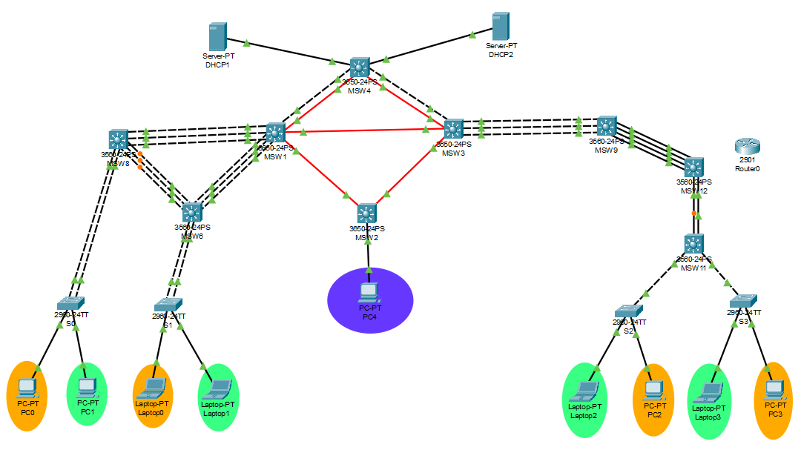

# CHAPINRED — Manual Técnico
## Proyecto 1 · Redes de Computadoras 2 · USAC Facultad de Ingeniería
**Carné:** 202204496  
**Repositorio:** `REDES2_1S2026_202204496`  
**Carpeta:** `Proyecto1/`  
**Protocolo de enrutamiento:** OSPF (carné par)

---

## 1. Resumen del Proyecto

ChapinRed es una red corporativa multi-edificio simulada en Cisco Packet Tracer. Implementa:

- Segmentación por VLANs con nomenclatura estandarizada
- Enrutamiento dinámico OSPF (área 0) entre todos los edificios
- Agregación de enlaces LACP (edificio izquierdo) y PAgP (edificio derecho)
- DHCP con relay (ip helper-address) para asignación dinámica en todas las VLANs
- ACLs extendidas para control de tráfico entre VLANs
- VTP para propagación automática de VLANs
- STP Rapid-PVST para prevención de bucles

El número de carné 202204496 determina X=96, usado en todas las redes: `192.188.96.0/24` para VLANs y `10.4.96.0/24` para enlaces L3.

---

## 2. Topología de Red

### 2.1 Dispositivos y roles

| Dispositivo | Modelo | Rol | VTP | OSPF router-id |
|-------------|--------|-----|-----|----------------|
| MSW4 | Cisco 3650 | Hub central, gateway VLANs, DHCP relay | Server | 1.1.1.1 |
| MSW1 | Cisco 3650 | Distribución edificio IZQ | Server | 2.2.2.2 |
| MSW3 | Cisco 3650 | Distribución edificio DER | Server | 3.3.3.3 |
| MSW2 | Cisco 3650 | Edificio Admin, gateway VLAN99 | Server | 4.4.4.4 |
| MSW9 | Cisco 3560 | Acceso DER, enlace L2 hacia MSW3 | Client | 5.5.5.5 |
| MSW8 | Cisco 3560 | Acceso IZQ, distribución Switch0/Switch1 | Client | — |
| MSW6 | Cisco 3560 | Acceso IZQ, distribución Switch0/Switch1 | Client | — |
| MSW12 | Cisco 3560 | Puente L2 entre MSW9 y MSW11 | Client | — |
| MSW11 | Cisco 3560 | Acceso DER, distribución Switch2/Switch3 | Client | — |
| Switch0 | Cisco 2960 | Acceso IZQ (PC0 Naranja, PC1 Verde) | Client | — |
| Switch1 | Cisco 2960 | Acceso IZQ (Laptop0 Naranja, Laptop1 Verde) | Client | — |
| Switch2 | Cisco 2960 | Acceso DER (Laptop2 Verde, PC2 Naranja) | Client | — |
| Switch3 | Cisco 2960 | Acceso DER (Laptop3 Verde, PC3 Naranja) | Client | — |
| DHCP1 | Server-PT | DHCP para VLANs 10 y 20 (IZQ) | — | — |
| DHCP2 | Server-PT | DHCP para VLANs 30 y 40 (DER) | — | — |
| PC4 | PC-PT | Host VLAN 99 Admin | — | — |

> **¿Por qué MSW4 es VTP Server y no los otros 3650?**  
> MSW4 actúa como hub central de toda la red. Al tener el número de revisión VTP más alto y ser el punto de sincronización, centralizar el rol Server en MSW4 (y MSW1/MSW3/MSW2 también como Server para redundancia) garantiza que todos los clientes reciban las VLANs correctamente. MSW4 tiene conexión trunk directa hacia MSW1 y MSW3, que a su vez propagan a los switches de acceso.

> **¿Por qué no se usó Router0 (Cisco 2901) como Gateway?**  
> El Cisco 2901 en Packet Tracer presenta limitaciones con EtherChannels en puertos de módulo WIC (FastEthernet 0/0/x): no acepta `no switchport` ni agregación L3 confiable. En su lugar se usó **MSW12** (Cisco 3560) como puente L2 puro entre MSW9 y MSW11, lo que resolvió el problema de DHCP en el lado derecho sin modificar la topología física del enrutamiento.


---

### 2.2 VLANs

| ID | Nombre | Subred | Gateway | Hosts útiles |
|----|--------|--------|---------|--------------|
| 10 | VLAN_Naranja_EdificioIZQ_202204496 | 192.188.96.0/26 | 192.188.96.1 | 62 |
| 20 | VLAN_Verde_EdificioIZQ_202204496 | 192.188.96.64/26 | 192.188.96.65 | 62 |
| 30 | VLAN_Naranja_EdificioDER_202204496 | 192.188.96.128/26 | 192.188.96.129 | 62 |
| 40 | VLAN_Verde_EdificioDER_202204496 | 192.188.96.192/26 | 192.188.96.193 | 62 |
| 99 | VLAN_ADMIN_202204496 | 192.188.97.0/27 | 192.188.97.1 | 30 |

**Convención de nombres:** `VLAN_[Color]_Edificio[IZQ/DER]_[Carné]`

### 2.3 Mapeo dispositivos finales ↔ VLANs

| Dispositivo | VLAN | IP (DHCP) | Color |
|-------------|------|-----------|-------|
| PC0 | 10 | 192.188.96.3 | Naranja IZQ |
| PC1 | 20 | 192.188.96.66 | Verde IZQ |
| Laptop0 | 10 | 192.188.96.5 | Naranja IZQ |
| Laptop1 | 20 | 192.188.96.67 | Verde IZQ |
| PC2 | 30 | 192.188.96.132 | Naranja DER |
| PC3 | 30 | 192.188.96.133 | Naranja DER |
| Laptop2 | 40 | 192.188.96.195 | Verde DER |
| Laptop3 | 40 | 192.188.96.196 | Verde DER |
| PC4 | 99 | 192.188.97.2 | Admin |

---

## 3. Direccionamiento IP — Subnetting

### 3.1 VLANs de usuario — FLSM /26 (192.188.96.0/24)

Se usó FLSM (bloques iguales de /26) porque las 4 VLANs de usuario tienen el mismo número de hosts requeridos (~60 dispositivos máximo por VLAN).

| VLAN | Red | Máscara | Gateway | Broadcast | Rango hosts |
|------|-----|---------|---------|-----------|-------------|
| 10 | 192.188.96.0 | /26 (255.255.255.192) | 192.188.96.1 | 192.188.96.63 | .2 – .62 |
| 20 | 192.188.96.64 | /26 | 192.188.96.65 | 192.188.96.127 | .66 – .126 |
| 30 | 192.188.96.128 | /26 | 192.188.96.129 | 192.188.96.191 | .130 – .190 |
| 40 | 192.188.96.192 | /26 | 192.188.96.193 | 192.188.96.255 | .194 – .254 |

### 3.2 VLAN 99 Admin — VLSM /27 (192.188.97.0/24)

Se usó VLSM para la VLAN Admin ya que requiere menos hosts (máximo 30). Esto optimiza el espacio de direccionamiento.

| VLAN | Red | Máscara | Gateway | Broadcast | Rango hosts |
|------|-----|---------|---------|-----------|-------------|
| 99 | 192.188.97.0 | /27 (255.255.255.224) | 192.188.97.1 | 192.188.97.31 | .2 – .30 |

### 3.3 IPs estáticas — Servidores DHCP

| Servidor | IP | Máscara | Gateway | VLAN acceso |
|----------|----|---------|---------|-------------|
| DHCP1 | 192.188.96.2 | /26 | 192.188.96.1 | VLAN 10 (en MSW4 Gi1/0/1) |
| DHCP2 | 192.188.96.130 | /26 | 192.188.96.129 | VLAN 30 (en MSW4 Gi1/0/2) |

> Los servidores DHCP tienen IP estática porque deben ser alcanzables siempre desde MSW4 para que el relay (ip helper-address) funcione correctamente. Un servidor DHCP con IP dinámica rompería el relay.

### 3.4 Enlaces L3 punto a punto — FLSM /30 (10.4.96.0/24)

Se usaron /30 porque cada enlace punto a punto solo necesita 2 IPs útiles. Esto maximiza la cantidad de enlaces disponibles en la red 10.4.96.0/24.

| Enlace | Red /30 | IP extremo A | IP extremo B |
|--------|---------|--------------|--------------|
| MSW4 ↔ MSW1 | 10.4.96.0/30 | MSW4: .1 | MSW1: .2 |
| MSW4 ↔ MSW3 | 10.4.96.4/30 | MSW4: .5 | MSW3: .6 |
| MSW1 ↔ MSW3 | 10.4.96.8/30 | MSW1: .9 | MSW3: .10 |
| MSW1 ↔ MSW2 | 10.4.96.12/30 | MSW1: .13 | MSW2: .14 |
| MSW3 ↔ MSW2 | 10.4.96.16/30 | MSW3: .17 | MSW2: .18 |
| MSW3 ↔ MSW9 (Vlan96) | 10.4.96.24/30 | MSW3: .25 | MSW9: .26 |

---

## 4. VTP — VLAN Trunking Protocol

**Dominio:** `CHAPINRED_202204496`  
**Password:** `Chapin2024`  
**Versión:** 2

| Dispositivo | Modo VTP | Justificación |
|-------------|----------|---------------|
| MSW4, MSW1, MSW2, MSW3 | Server | Crean y propagan VLANs. Los 3650 de core/distribución son los únicos que deben modificar la base de VLANs |
| MSW8, MSW6, MSW9, MSW11, MSW12 | Client | Solo reciben VLANs, no pueden crear ni eliminar. Reducen el riesgo de borrado accidental |
| Switch0–3 | Client | Switches de acceso. Solo necesitan conocer sus VLANs asignadas |

> **VTP Transparent** NO se usa porque requeriría configurar VLANs manualmente en cada switch. En modo Transparent el switch no propaga ni recibe actualizaciones VTP, lo que obligaría a crear las 5 VLANs dispositivo por dispositivo — trabajo innecesario con más de 10 switches.

---

## 5. Agregación de Enlaces

### 5.1 LACP — Edificio Izquierdo (5 enlaces)

LACP (IEEE 802.3ad) es el estándar abierto de agregación de enlaces. Se usa en el edificio izquierdo porque el proyecto lo requiere específicamente para este lado.

| EtherChannel | Dispositivos | Puertos | Modo | VLANs |
|-------------|--------------|---------|------|-------|
| Po1 | MSW1 ↔ MSW8 | Gi1/0/1-3 ↔ Gi0/1-2+Fa0/1 | active/passive | 10,20,30,40,99 |
| Po2 | MSW1 ↔ MSW6 | Gi1/0/4-6 ↔ Gi0/1-2+Fa0/1 | active/passive | 10,20,30,40,99 |
| Po5 | MSW8 ↔ MSW6 | Fa0/2-4 ↔ Fa0/2-4 | active/passive | 10,20,30,40,99 |
| Po3 | MSW8 ↔ Switch0 | Fa0/5-6 ↔ Fa0/1-2 | active/passive | 10,20 |
| Po4 | MSW6 ↔ Switch1 | Fa0/5-6 ↔ Fa0/1-2 | active/passive | 10,20 |

> **¿Por qué hay más cables entre algunos switches?** Los EtherChannels agrupan múltiples cables físicos en un canal lógico. Más cables = más ancho de banda agregado y redundancia. Si un cable falla, el canal sigue activo con los restantes.

### 5.2 PAgP — Edificio Derecho (3 enlaces)

PAgP es el protocolo propietario de Cisco para agregación de enlaces. Se usa en el edificio derecho por requerimiento del proyecto.

| EtherChannel | Dispositivos | Puertos | Modo | VLANs |
|-------------|--------------|---------|------|-------|
| Po1 (MSW3) | MSW3 ↔ MSW9 | Gi1/0/1-3 ↔ Gi0/1-2+Fa0/1 | desirable/auto | 10,20,30,40,99 |
| Po2 (MSW9) | MSW9 ↔ MSW12 | Fa0/2-5 ↔ Fa0/2-5 | desirable/auto | 10,20,30,40,99 |

---

## 6. OSPF — Enrutamiento Dinámico

Se usa OSPF porque el carné 202204496 es par. OSPF área 0 (backbone) conecta todos los switches multicapa L3.

**¿Por qué OSPF y no rutas estáticas?**  
Las rutas estáticas requieren configuración manual en cada dispositivo y no se adaptan automáticamente a cambios. OSPF descubre y propaga rutas automáticamente, y recalcula rutas ante fallos en segundos.

| Dispositivo | Router-ID | Redes anunciadas |
|-------------|-----------|-----------------|
| MSW4 | 1.1.1.1 | 10.4.96.0/30, 10.4.96.4/30, VLANs 10/20/30/40/99 |
| MSW1 | 2.2.2.2 | 10.4.96.0/30, 10.4.96.8/30, 10.4.96.12/30 |
| MSW3 | 3.3.3.3 | 10.4.96.4/30, 10.4.96.8/30, 10.4.96.16/30 |
| MSW2 | 4.4.4.4 | 10.4.96.12/30, 10.4.96.16/30, 192.188.97.0/27 |
| MSW9 | 5.5.5.5 | 10.4.96.24/30 (Vlan96) |

---

## 7. DHCP — Configuración Completa

El DHCP permite que los dispositivos finales obtengan IP automáticamente. **No se permite IP estática en PCs/Laptops** según la rúbrica del proyecto.

### 7.1 DHCP1 — Edificio Izquierdo (IP estática: 192.188.96.2)

Configurado vía GUI en Packet Tracer → Services → DHCP:

| Pool | Gateway | DNS | Start IP | Max Users |
|------|---------|-----|----------|-----------|
| VLAN10_Naranja_IZQ | 192.188.96.1 | 8.8.8.8 | 192.188.96.3 | 60 |
| VLAN20_Verde_IZQ | 192.188.96.65 | 8.8.8.8 | 192.188.96.66 | 60 |

### 7.2 DHCP2 — Edificio Derecho (IP estática: 192.188.96.130)

| Pool | Gateway | DNS | Start IP | Max Users |
|------|---------|-----|----------|-----------|
| VLAN30_Naranja_DER | 192.188.96.129 | 8.8.8.8 | 192.188.96.131 | 60 |
| VLAN40_Verde_DER | 192.188.96.193 | 8.8.8.8 | 192.188.96.194 | 60 |

### 7.3 DHCP Relay — ip helper-address en MSW4

El relay DHCP es necesario porque los servidores DHCP están en una subred diferente a los clientes. Sin relay, el broadcast DHCP no cruza routers. MSW4 recibe el broadcast de cada VLAN y lo reenvía como unicast al servidor DHCP correspondiente.

```
interface Vlan10
 ip helper-address 192.188.96.2    ! Reenvía solicitudes VLAN10 → DHCP1

interface Vlan20
 ip helper-address 192.188.96.2    ! Reenvía solicitudes VLAN20 → DHCP1

interface Vlan30
 ip helper-address 192.188.96.130  ! Reenvía solicitudes VLAN30 → DHCP2

interface Vlan40
 ip helper-address 192.188.96.130  ! Reenvía solicitudes VLAN40 → DHCP2
```

### 7.4 DHCP Admin — MSW2 (local)

MSW2 sirve DHCP localmente para VLAN99 ya que es el gateway de esa VLAN:

```
ip dhcp excluded-address 192.188.97.1
ip dhcp pool VLAN99_ADMIN
 network 192.188.97.0 255.255.255.224
 default-router 192.188.97.1
 dns-server 8.8.8.8
```

---

## 8. ACLs — Políticas de Seguridad

Las ACLs controlan qué VLANs pueden comunicarse entre sí. Se aplican en las SVIs de MSW4 (el gateway centralizado) en dirección `in`, lo que evalúa el tráfico cuando entra al router desde cada VLAN.

### 8.1 Política de comunicación

| Origen | Destino Naranja | Destino Verde | Destino Admin |
|--------|-----------------|---------------|---------------|
| VLAN Naranja (10/30) |  Permitido |  Bloqueado |  Bloqueado |
| VLAN Verde (20/40) |  Bloqueado |  Permitido |  Bloqueado |
| VLAN Admin (99) |  Puede iniciar |  Puede iniciar | — |
| Otras → Admin |  Bloqueado |  Bloqueado |  Bloqueado |

### 8.2 Comandos ACLs en MSW4

```
configure terminal

! === ACL_NARANJA: aplicada en Vlan10 y Vlan30 ===
! Permite Naranja IZQ ↔ Naranja DER
! Bloquea hacia Verde y Admin
ip access-list extended ACL_NARANJA
 permit ip 192.188.96.0 0.0.0.63 192.188.96.128 0.0.0.63
 permit ip 192.188.96.128 0.0.0.63 192.188.96.0 0.0.0.63
 deny ip any 192.188.96.64 0.0.0.63
 deny ip any 192.188.96.192 0.0.0.63
 deny ip any 192.188.97.0 0.0.0.31
 permit ip any any

! === ACL_VERDE: aplicada en Vlan20 y Vlan40 ===
! Permite Verde IZQ ↔ Verde DER
! Bloquea hacia Naranja y Admin
ip access-list extended ACL_VERDE
 permit ip 192.188.96.64 0.0.0.63 192.188.96.192 0.0.0.63
 permit ip 192.188.96.192 0.0.0.63 192.188.96.64 0.0.0.63
 deny ip any 192.188.96.0 0.0.0.63
 deny ip any 192.188.96.128 0.0.0.63
 deny ip any 192.188.97.0 0.0.0.31
 permit ip any any

! === ACL_ADMIN_IN: aplicada en Vlan99 ===
! Bloquea que otras VLANs inicien comunicación hacia Admin
! Admin puede salir libremente (tráfico de retorno no pasa por esta ACL in)
ip access-list extended ACL_ADMIN_IN
 deny ip 192.188.96.0 0.0.0.63 192.188.97.0 0.0.0.31
 deny ip 192.188.96.64 0.0.0.63 192.188.97.0 0.0.0.31
 deny ip 192.188.96.128 0.0.0.63 192.188.97.0 0.0.0.31
 deny ip 192.188.96.192 0.0.0.63 192.188.97.0 0.0.0.31
 permit ip any any

! === Aplicar en SVIs ===
interface Vlan10
 ip access-group ACL_NARANJA in

interface Vlan20
 ip access-group ACL_VERDE in

interface Vlan30
 ip access-group ACL_NARANJA in

interface Vlan40
 ip access-group ACL_VERDE in

interface Vlan99
 ip access-group ACL_ADMIN_IN in
end
write memory
```

> **¿Por qué `in` y no `out`?**  
> Aplicar `in` en la SVI evalúa el tráfico cuando el host lo envía hacia el router. Es más eficiente porque descarta el paquete lo antes posible, antes de que el router procese el enrutamiento. Aplicar `out` evaluaría después del routing, desperdiciando recursos.

---

## 9. Configuraciones CLI Completas

### 9.1 MSW4 — Hub Central (Cisco 3650)

MSW4 es el corazón de la red. Concentra: gateway de todas las VLANs (SVIs), DHCP relay, enlaces L3 OSPF hacia MSW1 y MSW3, trunks L2 para que las SVIs suban, y las ACLs de seguridad.

```
enable
configure terminal
hostname MSW4
ip routing
vtp mode server
vtp domain CHAPINRED_202204496
vtp password Chapin2024
vtp version 2
vlan 10
 name VLAN_Naranja_EdificioIZQ_202204496
vlan 20
 name VLAN_Verde_EdificioIZQ_202204496
vlan 30
 name VLAN_Naranja_EdificioDER_202204496
vlan 40
 name VLAN_Verde_EdificioDER_202204496
vlan 99
 name VLAN_ADMIN_202204496

! Puerto hacia DHCP1 (access VLAN10)
interface GigabitEthernet1/0/1
 switchport mode access
 switchport access vlan 10
 no shutdown

! Puerto hacia DHCP2 (access VLAN30)
interface GigabitEthernet1/0/2
 switchport mode access
 switchport access vlan 30
 no shutdown

! Trunk L2 hacia MSW1 (necesario para que SVIs suban)
interface GigabitEthernet1/0/3
 switchport trunk encapsulation dot1q
 switchport mode trunk
 switchport trunk allowed vlan 10,20,30,40,99
 no shutdown

! Trunk L2 hacia MSW3 (necesario para que SVIs suban)
interface GigabitEthernet1/0/4
 switchport trunk encapsulation dot1q
 switchport mode trunk
 switchport trunk allowed vlan 10,20,30,40,99
 no shutdown

! Enlace L3 hacia MSW1
interface GigabitEthernet1/1/1
 no switchport
 ip address 10.4.96.1 255.255.255.252
 no shutdown

! Enlace L3 hacia MSW3
interface GigabitEthernet1/1/2
 no switchport
 ip address 10.4.96.5 255.255.255.252
 no shutdown

! SVIs inter-VLAN con DHCP Relay
interface Vlan10
 ip address 192.188.96.1 255.255.255.192
 ip helper-address 192.188.96.2
 no shutdown

interface Vlan20
 ip address 192.188.96.65 255.255.255.192
 ip helper-address 192.188.96.2
 no shutdown

interface Vlan30
 ip address 192.188.96.129 255.255.255.192
 ip helper-address 192.188.96.130
 no shutdown

interface Vlan40
 ip address 192.188.96.193 255.255.255.192
 ip helper-address 192.188.96.130
 no shutdown

interface Vlan99
 ip address 192.188.97.1 255.255.255.224
 no shutdown

router ospf 1
 router-id 1.1.1.1
 network 10.4.96.0 0.0.0.3 area 0
 network 10.4.96.4 0.0.0.3 area 0
 network 192.188.96.0 0.0.0.63 area 0
 network 192.188.96.64 0.0.0.63 area 0
 network 192.188.96.128 0.0.0.63 area 0
 network 192.188.96.192 0.0.0.63 area 0
 network 192.188.97.0 0.0.0.31 area 0

spanning-tree mode rapid-pvst
end
write memory
```

### 9.2 MSW1 — Distribución IZQ (Cisco 3650)

MSW1 conecta el edificio izquierdo con el core (MSW4) y el edificio derecho (MSW3 y MSW2). Maneja los 5 EtherChannels LACP hacia MSW8 y MSW6.

```
enable
configure terminal
hostname MSW1
ip routing
vtp mode server
vtp domain CHAPINRED_202204496
vtp password Chapin2024
vtp version 2

! Trunk L2 hacia MSW4
interface GigabitEthernet1/0/7
 switchport trunk encapsulation dot1q
 switchport mode trunk
 switchport trunk allowed vlan 10,20,30,40,99
 no shutdown

! Enlace L3 hacia MSW4
interface GigabitEthernet1/1/1
 no switchport
 ip address 10.4.96.2 255.255.255.252
 no shutdown

! Enlace L3 hacia MSW3
interface GigabitEthernet1/1/3
 no switchport
 ip address 10.4.96.9 255.255.255.252
 no shutdown

! Enlace L3 hacia MSW2
interface GigabitEthernet1/1/2
 no switchport
 ip address 10.4.96.13 255.255.255.252
 no shutdown

! LACP Po1 hacia MSW8 (active)
interface GigabitEthernet1/0/1
 channel-protocol lacp
 channel-group 1 mode active
 no shutdown
interface GigabitEthernet1/0/2
 channel-protocol lacp
 channel-group 1 mode active
 no shutdown
interface GigabitEthernet1/0/3
 channel-protocol lacp
 channel-group 1 mode active
 no shutdown
interface Port-channel1
 switchport trunk encapsulation dot1q
 switchport mode trunk
 switchport trunk allowed vlan 10,20,30,40,99

! LACP Po2 hacia MSW6 (active)
interface GigabitEthernet1/0/4
 channel-protocol lacp
 channel-group 2 mode active
 no shutdown
interface GigabitEthernet1/0/5
 channel-protocol lacp
 channel-group 2 mode active
 no shutdown
interface GigabitEthernet1/0/6
 channel-protocol lacp
 channel-group 2 mode active
 no shutdown
interface Port-channel2
 switchport trunk encapsulation dot1q
 switchport mode trunk
 switchport trunk allowed vlan 10,20,30,40,99

router ospf 1
 router-id 2.2.2.2
 network 10.4.96.0 0.0.0.3 area 0
 network 10.4.96.8 0.0.0.3 area 0
 network 10.4.96.12 0.0.0.3 area 0

spanning-tree mode rapid-pvst
end
write memory
```

### 9.3 MSW3 — Distribución DER (Cisco 3650)

MSW3 conecta el edificio derecho con el core. Maneja PAgP hacia MSW9 y los enlaces L3 OSPF.

```
enable
configure terminal
hostname MSW3
ip routing
vtp mode server
vtp domain CHAPINRED_202204496
vtp password Chapin2024
vtp version 2

! Trunk L2 hacia MSW4
interface GigabitEthernet1/0/4
 switchport trunk encapsulation dot1q
 switchport mode trunk
 switchport trunk allowed vlan 10,20,30,40,99
 no shutdown

interface GigabitEthernet1/1/1
 no switchport
 ip address 10.4.96.6 255.255.255.252
 no shutdown

interface GigabitEthernet1/1/2
 no switchport
 ip address 10.4.96.17 255.255.255.252
 no shutdown

interface GigabitEthernet1/1/3
 no switchport
 ip address 10.4.96.10 255.255.255.252
 no shutdown

! PAgP Po1 hacia MSW9 (desirable)
interface GigabitEthernet1/0/1
 channel-protocol pagp
 channel-group 1 mode desirable
 no shutdown
interface GigabitEthernet1/0/2
 channel-protocol pagp
 channel-group 1 mode desirable
 no shutdown
interface GigabitEthernet1/0/3
 channel-protocol pagp
 channel-group 1 mode desirable
 no shutdown
interface Port-channel1
 switchport trunk encapsulation dot1q
 switchport mode trunk
 switchport trunk allowed vlan 10,20,30,40,99

router ospf 1
 router-id 3.3.3.3
 network 10.4.96.4 0.0.0.3 area 0
 network 10.4.96.8 0.0.0.3 area 0
 network 10.4.96.16 0.0.0.3 area 0

spanning-tree mode rapid-pvst
end
write memory
```

### 9.4 MSW2 — Admin (Cisco 3650)

MSW2 es el gateway de la VLAN99 Admin. Sirve DHCP local para PC4 y participa en OSPF.

```
enable
configure terminal
hostname MSW2
ip routing
vtp mode server
vtp domain CHAPINRED_202204496
vtp password Chapin2024
vtp version 2

interface GigabitEthernet1/1/1
 no switchport
 ip address 10.4.96.14 255.255.255.252
 no shutdown

interface GigabitEthernet1/1/2
 no switchport
 ip address 10.4.96.18 255.255.255.252
 no shutdown

! PC4 en VLAN99
interface GigabitEthernet1/0/1
 switchport mode access
 switchport access vlan 99
 spanning-tree portfast
 no shutdown

interface Vlan99
 ip address 192.188.97.1 255.255.255.224
 no shutdown

ip dhcp excluded-address 192.188.97.1
ip dhcp pool VLAN99_ADMIN
 network 192.188.97.0 255.255.255.224
 default-router 192.188.97.1
 dns-server 8.8.8.8

router ospf 1
 router-id 4.4.4.4
 network 10.4.96.12 0.0.0.3 area 0
 network 10.4.96.16 0.0.0.3 area 0
 network 192.188.97.0 0.0.0.31 area 0

spanning-tree mode rapid-pvst
end
write memory
```

### 9.5 MSW8 — Acceso IZQ (Cisco 3560)

MSW8 conecta MSW1 con MSW6 y con Switch0. Es cliente VTP, no necesita ip routing.

```
enable
configure terminal
hostname MSW8
vtp mode client
vtp domain CHAPINRED_202204496
vtp password Chapin2024

! LACP Po1 hacia MSW1 (passive)
interface GigabitEthernet0/1
 channel-protocol lacp
 channel-group 1 mode passive
 no shutdown
interface GigabitEthernet0/2
 channel-protocol lacp
 channel-group 1 mode passive
 no shutdown
interface FastEthernet0/1
 channel-protocol lacp
 channel-group 1 mode passive
 no shutdown
interface Port-channel1
 switchport trunk encapsulation dot1q
 switchport mode trunk
 switchport trunk allowed vlan 10,20,30,40,99

! LACP Po5 hacia MSW6 (active)
interface FastEthernet0/2
 channel-protocol lacp
 channel-group 5 mode active
 no shutdown
interface FastEthernet0/3
 channel-protocol lacp
 channel-group 5 mode active
 no shutdown
interface FastEthernet0/4
 channel-protocol lacp
 channel-group 5 mode active
 no shutdown
interface Port-channel5
 switchport trunk encapsulation dot1q
 switchport mode trunk
 switchport trunk allowed vlan 10,20,30,40,99

! LACP Po3 hacia Switch0 (active)
interface FastEthernet0/5
 channel-protocol lacp
 channel-group 3 mode active
 no shutdown
interface FastEthernet0/6
 channel-protocol lacp
 channel-group 3 mode active
 no shutdown
interface Port-channel3
 switchport trunk encapsulation dot1q
 switchport mode trunk
 switchport trunk allowed vlan 10,20

spanning-tree mode rapid-pvst
spanning-tree vlan 10,20 priority 4096
end
write memory
```

### 9.6 MSW6 — Acceso IZQ (Cisco 3560)

MSW6 trabaja en paralelo con MSW8, conecta MSW1 con MSW8 y con Switch1.

```
enable
configure terminal
hostname MSW6
vtp mode client
vtp domain CHAPINRED_202204496
vtp password Chapin2024

! LACP Po2 hacia MSW1 (passive)
interface GigabitEthernet0/1
 channel-protocol lacp
 channel-group 2 mode passive
 no shutdown
interface GigabitEthernet0/2
 channel-protocol lacp
 channel-group 2 mode passive
 no shutdown
interface FastEthernet0/1
 channel-protocol lacp
 channel-group 2 mode passive
 no shutdown
interface Port-channel2
 switchport trunk encapsulation dot1q
 switchport mode trunk
 switchport trunk allowed vlan 10,20,30,40,99

! LACP Po5 hacia MSW8 (passive)
interface FastEthernet0/2
 channel-protocol lacp
 channel-group 5 mode passive
 no shutdown
interface FastEthernet0/3
 channel-protocol lacp
 channel-group 5 mode passive
 no shutdown
interface FastEthernet0/4
 channel-protocol lacp
 channel-group 5 mode passive
 no shutdown
interface Port-channel5
 switchport trunk encapsulation dot1q
 switchport mode trunk
 switchport trunk allowed vlan 10,20,30,40,99

! LACP Po4 hacia Switch1 (active)
interface FastEthernet0/5
 channel-protocol lacp
 channel-group 4 mode active
 no shutdown
interface FastEthernet0/6
 channel-protocol lacp
 channel-group 4 mode active
 no shutdown
interface Port-channel4
 switchport trunk encapsulation dot1q
 switchport mode trunk
 switchport trunk allowed vlan 10,20

spanning-tree mode rapid-pvst
spanning-tree vlan 10,20 priority 4096
end
write memory
```

### 9.7 MSW9 — Acceso DER con OSPF (Cisco 3560)

MSW9 tiene ip routing activo para participar en OSPF. El PAgP hacia MSW3 es su enlace troncal y la Vlan96 es su enlace L3 hacia MSW3.

```
enable
configure terminal
hostname MSW9
ip routing
vtp mode client
vtp domain CHAPINRED_202204496
vtp password Chapin2024

! PAgP Po1 hacia MSW3 (auto)
interface GigabitEthernet0/1
 channel-protocol pagp
 channel-group 1 mode auto
 no shutdown
interface GigabitEthernet0/2
 channel-protocol pagp
 channel-group 1 mode auto
 no shutdown
interface FastEthernet0/1
 channel-group 1 mode auto
 no shutdown
interface Port-channel1
 switchport trunk encapsulation dot1q
 switchport mode trunk
 switchport trunk allowed vlan 10,20,30,40,96,99

! PAgP Po2 hacia MSW12 (desirable)
interface FastEthernet0/2
 channel-protocol pagp
 channel-group 2 mode desirable
 no shutdown
interface FastEthernet0/3
 channel-protocol pagp
 channel-group 2 mode desirable
 no shutdown
interface FastEthernet0/4
 channel-protocol pagp
 channel-group 2 mode desirable
 no shutdown
interface FastEthernet0/5
 channel-protocol pagp
 channel-group 2 mode desirable
 no shutdown
interface Port-channel2
 switchport trunk encapsulation dot1q
 switchport mode trunk
 switchport trunk allowed vlan 10,20,30,40,99

! Vlan96 — enlace L3 hacia MSW3 para OSPF
interface Vlan96
 ip address 10.4.96.26 255.255.255.252
 no shutdown

router ospf 1
 router-id 5.5.5.5
 network 10.4.96.24 0.0.0.3 area 0

spanning-tree mode rapid-pvst
end
write memory
```

### 9.8 MSW12 — Puente L2 (Cisco 3560)

MSW12 reemplaza a Router0. Funciona como switch L2 puro: no tiene ip routing, solo propaga VLANs entre MSW9 y MSW11.

> **¿Por qué MSW12 y no Router0?**  
> El Cisco 2901 (Router0) no soporta confiablemente EtherChannels con módulos WIC en Packet Tracer. MSW12 como L2 puro resuelve el problema sin agregar complejidad de routing. Las VLANs 30 y 40 se propagan por trunk y el gateway sigue siendo MSW4.

```
enable
configure terminal
hostname MSW12
no ip routing
vtp mode client
vtp domain CHAPINRED_202204496
vtp password Chapin2024

! Po1 hacia MSW9 (auto PAgP)
interface FastEthernet0/2
 channel-protocol pagp
 channel-group 1 mode auto
 no shutdown
interface FastEthernet0/3
 channel-protocol pagp
 channel-group 1 mode auto
 no shutdown
interface FastEthernet0/4
 channel-protocol pagp
 channel-group 1 mode auto
 no shutdown
interface FastEthernet0/5
 channel-protocol pagp
 channel-group 1 mode auto
 no shutdown
interface Port-channel1
 switchport trunk encapsulation dot1q
 switchport mode trunk
 switchport trunk allowed vlan 10,20,30,40,99

! Trunk L2 hacia MSW11
interface GigabitEthernet0/1
 switchport
 switchport trunk encapsulation dot1q
 switchport mode trunk
 switchport trunk allowed vlan 10,20,30,40,99
 no shutdown

interface GigabitEthernet0/2
 switchport
 switchport trunk encapsulation dot1q
 switchport mode trunk
 switchport trunk allowed vlan 10,20,30,40,99
 no shutdown
end
write memory
```

### 9.9 MSW11 — Acceso DER (Cisco 3560)

MSW11 distribuye las VLANs 30 y 40 hacia Switch2 y Switch3.

```
enable
configure terminal
hostname MSW11
vtp mode client
vtp domain CHAPINRED_202204496
vtp password Chapin2024

! Trunk L2 hacia MSW12
interface GigabitEthernet0/1
 switchport
 switchport trunk encapsulation dot1q
 switchport mode trunk
 switchport trunk allowed vlan 10,20,30,40,99
 no shutdown

interface GigabitEthernet0/2
 switchport
 switchport trunk encapsulation dot1q
 switchport mode trunk
 switchport trunk allowed vlan 10,20,30,40,99
 no shutdown

! Trunk hacia Switch2
interface FastEthernet0/1
 switchport trunk encapsulation dot1q
 switchport mode trunk
 switchport trunk allowed vlan 30,40
 no shutdown

! Trunk hacia Switch3
interface FastEthernet0/2
 switchport trunk encapsulation dot1q
 switchport mode trunk
 switchport trunk allowed vlan 30,40
 no shutdown

spanning-tree mode rapid-pvst
end
write memory
```

### 9.10 Switches de Acceso

Todos son Cisco 2960, VTP Client. Configuración similar:

```
! Switch0 (PC0-Naranja, PC1-Verde)
vtp mode client
vtp domain CHAPINRED_202204496
vtp password Chapin2024
interface FastEthernet0/1
 channel-protocol lacp
 channel-group 3 mode passive
 no shutdown
interface FastEthernet0/2
 channel-protocol lacp
 channel-group 3 mode passive
 no shutdown
interface Port-channel3
 switchport mode trunk
 switchport trunk allowed vlan 10,20
interface FastEthernet0/3
 switchport mode access
 switchport access vlan 10
 spanning-tree portfast
interface FastEthernet0/4
 switchport mode access
 switchport access vlan 20
 spanning-tree portfast

! Switch1 (Laptop0-Naranja, Laptop1-Verde) — igual estructura, usa Po4
! Switch2 (Laptop2-Verde VLAN40, PC2-Naranja VLAN30) — sin EtherChannel, trunk desde MSW11
! Switch3 (Laptop3-Verde VLAN40, PC3-Naranja VLAN30) — igual que Switch2
```

---

## 10. Pruebas Realizadas

### 10.1 OSPF — Vecindades

```
MSW4# show ip ospf neighbor
! 2.2.2.2 (MSW1) FULL/DR 
! 3.3.3.3 (MSW3) FULL/DR 

MSW3# show ip ospf neighbor
! 1.1.1.1 (MSW4) FULL 
! 4.4.4.4 (MSW2) FULL 
! 2.2.2.2 (MSW1) FULL 
! 5.5.5.5 (MSW9) FULL 
```

### 10.2 DHCP — Todos los dispositivos obtuvieron IP dinámica

| Dispositivo | IP obtenida | Servidor |
|-------------|-------------|----------|
| PC0 | 192.188.96.3 | DHCP1 |
| PC1 | 192.188.96.66 | DHCP1 |
| Laptop0 | 192.188.96.5 | DHCP1 |
| Laptop1 | 192.188.96.67 | DHCP1 |
| PC2 | 192.188.96.132 | DHCP2 |
| PC3 | 192.188.96.133 | DHCP2 |
| Laptop2 | 192.188.96.195 | DHCP2 |
| Laptop3 | 192.188.96.196 | DHCP2 |

### 10.3 Conectividad entre edificios (sin ACLs)

| Origen | Destino | Resultado |
|--------|---------|-----------|
| PC0 (Naranja IZQ) | 192.188.96.129 (GW Naranja DER) |  0% loss |
| PC2 (Naranja DER) | 192.188.96.1 (GW Naranja IZQ) |  0% loss |
| Laptop0 (Naranja IZQ) | 192.188.96.193 (GW Verde DER) |  0% loss |
| Laptop2 (Verde DER) | 192.188.96.65 (GW Verde IZQ) |  0% loss |

### 10.4 Verificación de ACLs

| Origen | Destino | Esperado | Resultado |
|--------|---------|----------|-----------|
| PC0 (Naranja IZQ .3) | PC2 (Naranja DER .132) |  Funciona |  0% loss |
| PC0 (Naranja IZQ .3) | PC1 (Verde IZQ .66) |  Bloqueado |  100% loss |
| PC0 (Naranja IZQ .3) | ADMIN (.97.1) |  Bloqueado |  100% loss |
| PC1 (Verde IZQ .66) | Laptop2 (Verde DER .195) |  Funciona |  0% loss |
| PC1 (Verde IZQ .66) | Laptop0 (Naranja IZQ .5) |  Bloqueado |  100% loss |
| PC1 (Verde IZQ .66) | ADMIN (.97.1) |  Bloqueado |  100% loss |

### 10.5 Comandos de verificación útiles

```bash
# OSPF
show ip ospf neighbor
show ip route ospf

# VTP y VLANs
show vtp status
show vlan brief

# EtherChannels
show etherchannel summary
show interfaces trunk

# DHCP
show ip dhcp binding        # en MSW2
show ip interface Vlan10    # ver helper-address

# ACLs
show ip access-lists
show ip interface Vlan10    # ver qué ACL está aplicada
```

---

## 11. Problema DHCP Lado Derecho — Solución

### Problema identificado
Router0 (Cisco 2901) no soporta EtherChannels confiables con módulos WIC en Packet Tracer. Los puertos Fa0/0/x no aceptan comandos L3 estándar como `no switchport` en configuración de channel-group, lo que impedía que las VLANs 30 y 40 llegaran a MSW11.

### Solución implementada
Se reemplazó Router0 por **MSW12** (Cisco 3560) configurado como switch L2 puro (`no ip routing`). MSW12 actúa como puente transparente entre MSW9 y MSW11, propagando las VLANs por trunk sin necesidad de routing adicional.

**Cadena de propagación DHCP lado derecho:**
```
PC2/PC3/Laptop2/Laptop3
  → Switch2/Switch3 (access VLAN30/40)
  → MSW11 (trunk VLAN30/40)
  → MSW12 (trunk, L2 puro)
  → MSW9 (trunk + PAgP Po1)
  → MSW3 (trunk + PAgP)
  → MSW4 (Vlan30/40 SVI con ip helper-address → DHCP2)
  → DHCP2 responde con IP del pool correcto
```

---

*Manual Técnico — ChapinRed · Carné 202204496 · USAC 2026*