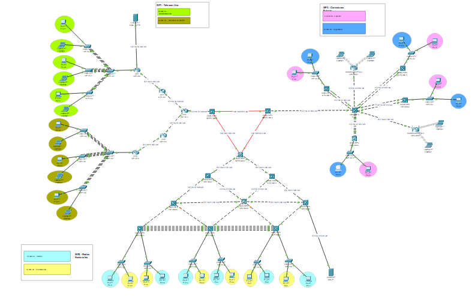

# Manual Técnico — Proyecto 2
# Telecom Uno, Redes Nacionales y Conexiones Futuras

**Estudiante:** Rodrigo Sebastian Castro Aguilar  
**Carné:** 202204496  
**Curso:** Redes de Computadoras 2  
**Sección:** — USAC, Facultad de Ingeniería  
**Archivo:** `Proyecto2_202204496.pkt`  

---

## Topología General


El proyecto interconecta tres ISPs mediante BGP en topología de triángulo:

- **ISP 1 — Telecom Uno:** Topología en árbol, OSPF, AS 128
- **ISP 2 — Redes Nacionales:** Topología jerárquica, OSPF + HSRP, AS 228
- **ISP 3 — Conexiones Futuras:** Topología hub-and-spoke, EIGRP, AS 328
- **Interconexión:** BGP entre INTER-MS1, INTER-MS2, INTER-MS3



---

## VLANs

### ISP 1 — Telecom Uno

| VLAN | Número |
|---|---|
| Administración | 10 |
| Atención al Cliente | 20 |

### ISP 2 — Redes Nacionales

| VLAN | Número |
|---|---|
| Ventas | 30 |
| Facturación | 40 |

### ISP 3 — Conexiones Futuras

| VLAN | Número |
|---|---|
| Soporte | 50 |
| Seguridad | 60 |

---

## Subneteo

### Interconexión BGP entre ISPs

Red base: `192.168.96.0/16` (últimos 2 dígitos carné = 96)

| Subred | # Hosts | IP de Red | Máscara | Primer Host | Último Host | Broadcast |
|---|---|---|---|---|---|---|
| Subred 1 (MS1↔MS2) | 2 | 192.168.96.0/30 | 255.255.255.252 | 192.168.96.1 | 192.168.96.2 | 192.168.96.3 |
| Subred 2 (MS2↔MS3) | 2 | 192.168.96.4/30 | 255.255.255.252 | 192.168.96.5 | 192.168.96.6 | 192.168.96.7 |
| Subred 3 (MS1↔MS3) | 2 | 192.168.96.8/30 | 255.255.255.252 | 192.168.96.9 | 192.168.96.10 | 192.168.96.11 |

---

### ISP 1 — Telecom Uno

Red base: `172.16.16.0/24` (último dígito carné = 6)

| Subred | # Hosts | IP de Red | Máscara | Primer Host | Último Host | Gateway | Broadcast |
|---|---|---|---|---|---|---|---|
| Administración | 126 | 172.16.16.0/25 | 255.255.255.128 | 172.16.16.1 | 172.16.16.126 | 172.16.16.1 | 172.16.16.127 |
| Atención al Cliente | 62 | 172.16.16.64/26 | 255.255.255.192 | 172.16.16.65 | 172.16.16.126 | 172.16.16.65 | 172.16.16.127 |
| Servicio DNS/HTTP | 14 | 172.16.16.128/28 | 255.255.255.240 | 172.16.16.129 | 172.16.16.142 | 172.16.16.129 | 172.16.16.143 |
| Subred 1 (R2↔R4) | 2 | 172.16.16.144/30 | 255.255.255.252 | 172.16.16.145 | 172.16.16.146 | — | 172.16.16.147 |
| Subred 2 (R1↔R2) | 2 | 172.16.16.148/30 | 255.255.255.252 | 172.16.16.149 | 172.16.16.150 | — | 172.16.16.151 |
| Subred 3 (R1↔R3) | 2 | 172.16.16.152/30 | 255.255.255.252 | 172.16.16.153 | 172.16.16.154 | — | 172.16.16.155 |
| Subred 4 (R3↔R5) | 2 | 172.16.16.156/30 | 255.255.255.252 | 172.16.16.157 | 172.16.16.158 | — | 172.16.16.159 |
| Subred 5 (R1↔INTER-MS1) | 2 | 172.16.16.160/30 | 255.255.255.252 | 172.16.16.161 | 172.16.16.162 | — | 172.16.16.163 |

---

### ISP 2 — Redes Nacionales

Red base: `172.16.26.0/24` (último dígito carné = 6)

| Subred | # Hosts | IP de Red | Máscara | Primer Host | Último Host | Gateway HSRP VIP | Broadcast |
|---|---|---|---|---|---|---|---|
| Ventas | 62 | 172.16.26.0/26 | 255.255.255.192 | 172.16.26.1 | 172.16.26.62 | 172.16.26.1 | 172.16.26.63 |
| Facturación | 62 | 172.16.26.64/26 | 255.255.255.192 | 172.16.26.65 | 172.16.26.126 | 172.16.26.65 | 172.16.26.127 |
| Servicio DHCP | 14 | 172.16.26.128/28 | 255.255.255.240 | 172.16.26.129 | 172.16.26.142 | — | 172.16.26.143 |
| Subred 1 (MS4↔MS5) | 2 | 172.16.26.144/30 | 255.255.255.252 | 172.16.26.145 | 172.16.26.146 | — | 172.16.26.147 |
| Subred 2 (MS5↔MS6) | 2 | 172.16.26.148/30 | 255.255.255.252 | 172.16.26.149 | 172.16.26.150 | — | 172.16.26.151 |
| Subred 3 (MS5↔MS8) | 2 | 172.16.26.152/30 | 255.255.255.252 | 172.16.26.153 | 172.16.26.154 | — | 172.16.26.155 |
| Subred 4 (MS5↔MS7) | 2 | 172.16.26.156/30 | 255.255.255.252 | 172.16.26.157 | 172.16.26.158 | — | 172.16.26.159 |
| Subred 5 (MS4↔MS7) | 2 | 172.16.26.160/30 | 255.255.255.252 | 172.16.26.161 | 172.16.26.162 | — | 172.16.26.163 |
| Subred 6 (MS6↔MS8) | 2 | 172.16.26.164/30 | 255.255.255.252 | 172.16.26.165 | 172.16.26.166 | — | 172.16.26.167 |
| Subred 7 (MS7↔INTER-MS2) | 2 | 172.16.26.168/30 | 255.255.255.252 | 172.16.26.169 | 172.16.26.170 | — | 172.16.26.171 |
| Subred 8 (MS8↔INTER-MS2) | 2 | 172.16.26.172/30 | 255.255.255.252 | 172.16.26.173 | 172.16.26.174 | — | 172.16.26.175 |

---

### ISP 3 — Conexiones Futuras

Red base: `172.16.32.0/24` (primer dígito carné = 2)

| Subred | # Hosts | IP de Red | Máscara | Primer Host | Último Host | Gateway | Broadcast |
|---|---|---|---|---|---|---|---|
| Soporte.1 (MS1) | 14 | 172.16.32.0/28 | 255.255.255.240 | 172.16.32.1 | 172.16.32.14 | 172.16.32.1 | 172.16.32.15 |
| Soporte.2 (MS2) | 14 | 172.16.32.16/28 | 255.255.255.240 | 172.16.32.17 | 172.16.32.30 | 172.16.32.17 | 172.16.32.31 |
| Soporte.3 (MS3) | 14 | 172.16.32.32/28 | 255.255.255.240 | 172.16.32.33 | 172.16.32.46 | 172.16.32.33 | 172.16.32.47 |
| Soporte.4 (MS4) | 14 | 172.16.32.48/28 | 255.255.255.240 | 172.16.32.49 | 172.16.32.62 | 172.16.32.49 | 172.16.32.63 |
| Seguridad.1 (MS1) | 14 | 172.16.32.64/28 | 255.255.255.240 | 172.16.32.65 | 172.16.32.78 | 172.16.32.65 | 172.16.32.79 |
| Seguridad.2 (MS2) | 14 | 172.16.32.80/28 | 255.255.255.240 | 172.16.32.81 | 172.16.32.94 | 172.16.32.81 | 172.16.32.95 |
| Seguridad.3 (MS3) | 14 | 172.16.32.96/28 | 255.255.255.240 | 172.16.32.97 | 172.16.32.110 | 172.16.32.97 | 172.16.32.111 |
| Seguridad.4 (MS4) | 14 | 172.16.32.112/28 | 255.255.255.240 | 172.16.32.113 | 172.16.32.126 | 172.16.32.113 | 172.16.32.127 |
| WLAN1 (WR1) | 14 | 172.16.32.128/28 | 255.255.255.240 | 172.16.32.129 | 172.16.32.142 | 172.16.32.129 | 172.16.32.143 |
| WLAN2 (WR2) | 14 | 172.16.32.144/28 | 255.255.255.240 | 172.16.32.145 | 172.16.32.158 | 172.16.32.145 | 172.16.32.159 |
| Subred 5 (HUB↔INTER-MS3) | 2 | 172.16.32.160/30 | 255.255.255.252 | 172.16.32.161 | 172.16.32.162 | — | 172.16.32.163 |
| Subred 6 (HUB↔MS1) | 2 | 172.16.32.164/30 | 255.255.255.252 | 172.16.32.165 | 172.16.32.166 | — | 172.16.32.167 |
| Subred 7 (HUB↔MS2) | 2 | 172.16.32.168/30 | 255.255.255.252 | 172.16.32.169 | 172.16.32.170 | — | 172.16.32.171 |
| Subred 8 (HUB↔MS3) | 2 | 172.16.32.172/30 | 255.255.255.252 | 172.16.32.173 | 172.16.32.174 | — | 172.16.32.175 |
| Subred 9 (HUB↔MS4) | 2 | 172.16.32.176/30 | 255.255.255.252 | 172.16.32.177 | 172.16.32.178 | — | 172.16.32.179 |
| Subred 10 (HUB↔WR1) | 2 | 172.16.32.180/30 | 255.255.255.252 | 172.16.32.181 | 172.16.32.182 | — | 172.16.32.183 |
| Subred 11 (HUB↔WR2) | 2 | 172.16.32.184/30 | 255.255.255.252 | 172.16.32.185 | 172.16.32.186 | — | 172.16.32.187 |

---

## Configuración Inalámbrica

| | ISP3-WR1 | ISP3-WR2 |
|---|---|---|
| SSID | ConexionesFuturasWR1 | ConexionesFuturasWR2 |
| Seguridad | WPA2 Personal | WPA2 Personal |
| Internet IP | 172.16.32.182 | 172.16.32.186 |
| Gateway WAN | 172.16.32.181 | 172.16.32.185 |
| Router IP (LAN) | 192.168.1.1 | 172.16.32.145 |

---

## Configuración BGP — Interconexión entre ISPs

### INTER-MS1 (AS 128)

```bash
enable
conf t
hostname INTER-MS1

interface GigabitEthernet1/0/1
 no switchport
 ip address 172.16.16.162 255.255.255.252

interface GigabitEthernet1/1/1
 no switchport
 ip address 192.168.96.9 255.255.255.252

interface GigabitEthernet1/1/2
 no switchport
 ip address 192.168.96.1 255.255.255.252

router bgp 128
 neighbor 192.168.96.2 remote-as 228
 neighbor 192.168.96.10 remote-as 328
 network 172.16.16.0 mask 255.255.255.0

router ospf 1
 network 172.16.16.160 0.0.0.3 area 0
 redistribute bgp 128 subnets
```

### INTER-MS2 (AS 228)

```bash
enable
conf t
hostname INTER-MS2

interface GigabitEthernet1/0/1
 no switchport
 ip address 172.16.26.174 255.255.255.252

interface GigabitEthernet1/0/2
 no switchport
 ip address 172.16.26.169 255.255.255.252

interface GigabitEthernet1/1/1
 no switchport
 ip address 192.168.96.5 255.255.255.252

interface GigabitEthernet1/1/2
 no switchport
 ip address 192.168.96.2 255.255.255.252

router bgp 228
 neighbor 192.168.96.1 remote-as 128
 neighbor 192.168.96.6 remote-as 328
 network 172.16.26.0 mask 255.255.255.0

router ospf 1
 network 172.16.26.168 0.0.0.3 area 0
 network 172.16.26.172 0.0.0.3 area 0
 redistribute bgp 228 subnets
```

### INTER-MS3 (AS 328)

```bash
enable
conf t
hostname INTER-MS3

interface GigabitEthernet1/0/1
 no switchport
 ip address 172.16.32.161 255.255.255.252

interface GigabitEthernet1/1/1
 no switchport
 ip address 192.168.96.10 255.255.255.252

interface GigabitEthernet1/1/2
 no switchport
 ip address 192.168.96.6 255.255.255.252

router bgp 328
 neighbor 192.168.96.9 remote-as 128
 neighbor 192.168.96.5 remote-as 228
 network 172.16.32.0 mask 255.255.255.0

router eigrp 1
 network 172.16.32.160 0.0.0.3
 redistribute bgp 328 metric 1000 100 255 1 1500
```

---

## Configuración ISP 1 — Telecom Uno

### ISP1-R1

```bash
interface GigabitEthernet0/0
 ip address 172.16.16.154 255.255.255.252

interface GigabitEthernet0/1
 ip address 172.16.16.161 255.255.255.252

interface GigabitEthernet0/2
 ip address 172.16.16.150 255.255.255.252

router ospf 1
 network 172.16.16.148 0.0.0.3 area 0
 network 172.16.16.152 0.0.0.3 area 0
 network 172.16.16.160 0.0.0.3 area 0
```

### ISP1-R2

```bash
interface GigabitEthernet0/1
 ip address 172.16.16.146 255.255.255.252

interface GigabitEthernet0/2
 ip address 172.16.16.149 255.255.255.252

router ospf 1
 network 172.16.16.144 0.0.0.3 area 0
 network 172.16.16.148 0.0.0.3 area 0
```

### ISP1-R3

```bash
interface GigabitEthernet0/0
 ip address 172.16.16.153 255.255.255.252

interface GigabitEthernet0/1
 ip address 172.16.16.158 255.255.255.252

router ospf 1
 network 172.16.16.152 0.0.0.3 area 0
 network 172.16.16.156 0.0.0.3 area 0
```

### ISP1-R4 (Administración — VLAN 10)

```bash
interface GigabitEthernet0/0.10
 encapsulation dot1Q 10
 ip address 172.16.16.1 255.255.255.128
 ip helper-address 172.16.26.130

interface GigabitEthernet0/1
 ip address 172.16.16.145 255.255.255.252

interface GigabitEthernet0/2
 ip address 172.16.16.129 255.255.255.252

router ospf 1
 network 172.16.16.0 0.0.0.127 area 0
 network 172.16.16.128 0.0.0.3 area 0
 network 172.16.16.144 0.0.0.3 area 0
```

### ISP1-R5 (Atención al Cliente — VLAN 20)

```bash
interface GigabitEthernet0/0.20
 encapsulation dot1Q 20
 ip address 172.16.16.65 255.255.255.192
 ip helper-address 172.16.26.130

interface GigabitEthernet0/1
 ip address 172.16.16.157 255.255.255.252

router ospf 1
 network 172.16.16.64 0.0.0.63 area 0
 network 172.16.16.156 0.0.0.3 area 0
```

### Servidor DNS-HTTP

- **IP:** 172.16.16.130 / 255.255.255.240
- **Gateway:** 172.16.16.129
- **DNS Record:** `www.proyecto2_202204496.com` → 172.16.16.130
- **HTTP:** Página estática con datos del estudiante

---

## Configuración ISP 2 — Redes Nacionales

### HSRP — ISP2-MS5 (Active) y ISP2-MS4 (Standby)

```bash
! ISP2-MS5 (Priority 200 — Active)
interface Vlan30
 ip address 172.16.26.2 255.255.255.192
 ip helper-address 172.16.26.130
 standby 1 ip 172.16.26.1
 standby 1 priority 200
 standby 1 preempt

interface Vlan40
 ip address 172.16.26.66 255.255.255.192
 ip helper-address 172.16.26.130
 standby 2 ip 172.16.26.65
 standby 2 priority 200
 standby 2 preempt

! ISP2-MS4 (Priority 150 — Standby)
interface Vlan30
 ip address 172.16.26.3 255.255.255.192
 ip helper-address 172.16.26.130
 standby 1 ip 172.16.26.1
 standby 1 priority 150
 standby 1 preempt

interface Vlan40
 ip address 172.16.26.67 255.255.255.192
 ip helper-address 172.16.26.130
 standby 2 ip 172.16.26.65
 standby 2 priority 150
 standby 2 preempt
```

### ISP2-MS6 (Standby adicional)

```bash
interface Vlan30
 ip address 172.16.26.4 255.255.255.192
 ip helper-address 172.16.26.130
 standby 1 ip 172.16.26.1
 standby 1 priority 100
 standby 1 preempt

interface Vlan40
 ip address 172.16.26.68 255.255.255.192
 ip helper-address 172.16.26.130
 standby 2 ip 172.16.26.65
 standby 2 priority 100
 standby 2 preempt
```

### Servidor DHCP (172.16.26.130)

| Pool | Default Gateway | DNS Server | Start IP | Máscara |
|---|---|---|---|---|
| ADMINISTRACION | 172.16.16.1 | 172.16.16.130 | 172.16.16.2 | 255.255.255.192 |
| ATENCION_AL_CLIENTE | 172.16.16.65 | 172.16.16.130 | 172.16.16.66 | 255.255.255.192 |
| VENTAS | 172.16.26.1 | 172.16.16.130 | 172.16.26.5 | 255.255.255.192 |
| FACTURACION | 172.16.26.65 | 172.16.16.130 | 172.16.26.69 | 255.255.255.192 |
| SOPORTE1 | 172.16.32.1 | 172.16.16.130 | 172.16.32.2 | 255.255.255.240 |
| SOPORTE2 | 172.16.32.17 | 172.16.16.130 | 172.16.32.18 | 255.255.255.240 |
| SOPORTE3 | 172.16.32.33 | 172.16.16.130 | 172.16.32.34 | 255.255.255.240 |
| SOPORTE4 | 172.16.32.49 | 172.16.16.130 | 172.16.32.50 | 255.255.255.240 |
| SEGURIDAD1 | 172.16.32.65 | 172.16.16.130 | 172.16.32.66 | 255.255.255.240 |
| SEGURIDAD2 | 172.16.32.81 | 172.16.16.130 | 172.16.32.82 | 255.255.255.240 |
| SEGURIDAD3 | 172.16.32.97 | 172.16.16.130 | 172.16.32.98 | 255.255.255.240 |
| SEGURIDAD4 | 172.16.32.113 | 172.16.16.130 | 172.16.32.114 | 255.255.255.240 |

---

## Configuración ISP 3 — Conexiones Futuras

### ISP3-HUB

```bash
interface GigabitEthernet1/0/1
 ip address 172.16.32.162 255.255.255.252

interface Port-channel1
 ip address 172.16.32.166 255.255.255.252

interface Port-channel2
 ip address 172.16.32.169 255.255.255.252

interface Port-channel3
 ip address 172.16.32.173 255.255.255.252

interface Port-channel4
 ip address 172.16.32.178 255.255.255.252

interface GigabitEthernet1/0/4
 ip address 172.16.32.181 255.255.255.252

interface GigabitEthernet1/0/9
 ip address 172.16.32.185 255.255.255.252

router eigrp 1
 network 172.16.32.160 0.0.0.3
 network 172.16.32.164 0.0.0.3
 network 172.16.32.168 0.0.0.3
 network 172.16.32.172 0.0.0.3
 network 172.16.32.176 0.0.0.3
 network 172.16.32.180 0.0.0.3
 network 172.16.32.184 0.0.0.3
```

### ISP3-MS1 (Spoke 1)

```bash
interface Port-channel1
 ip address 172.16.32.165 255.255.255.252

interface Vlan50
 ip address 172.16.32.1 255.255.255.240
 ip helper-address 172.16.26.130

interface Vlan60
 ip address 172.16.32.65 255.255.255.240
 ip helper-address 172.16.26.130

router eigrp 1
 network 172.16.32.164 0.0.0.3
 network 172.16.32.0 0.0.0.15
 network 172.16.32.64 0.0.0.15
```

### ISP3-MS2 (Spoke 2)

```bash
interface Port-channel2
 ip address 172.16.32.170 255.255.255.252

interface Vlan50
 ip address 172.16.32.17 255.255.255.240
 ip helper-address 172.16.26.130

interface Vlan60
 ip address 172.16.32.81 255.255.255.240
 ip helper-address 172.16.26.130

router eigrp 1
 network 172.16.32.168 0.0.0.3
 network 172.16.32.16 0.0.0.15
 network 172.16.32.80 0.0.0.15
```

### ISP3-MS3 (Spoke 3)

```bash
interface Port-channel3
 ip address 172.16.32.174 255.255.255.252

interface Vlan50
 ip address 172.16.32.33 255.255.255.240
 ip helper-address 172.16.26.130

interface Vlan60
 ip address 172.16.32.97 255.255.255.240
 ip helper-address 172.16.26.130

router eigrp 1
 network 172.16.32.172 0.0.0.3
 network 172.16.32.32 0.0.0.15
 network 172.16.32.96 0.0.0.15
```

### ISP3-MS4 (Spoke 4)

```bash
interface Port-channel4
 ip address 172.16.32.177 255.255.255.252

interface Vlan50
 ip address 172.16.32.49 255.255.255.240
 ip helper-address 172.16.26.130

interface Vlan60
 ip address 172.16.32.113 255.255.255.240
 ip helper-address 172.16.26.130

router eigrp 1
 network 172.16.32.176 0.0.0.3
 network 172.16.32.48 0.0.0.15
 network 172.16.32.112 0.0.0.15
```

---

## Reglas de Comunicación (ACLs)

Según el enunciado, las reglas de comunicación entre departamentos son:

| Departamento | Tráfico de salida hacia | Tráfico de entrada desde |
|---|---|---|
| Seguridad | Todos los deptos | Ninguno |
| Soporte | Todos los deptos | Todos los deptos |
| Administración | Todos los deptos | Todos los deptos |
| Atención al Cliente | Solo Ventas | Solo Ventas |
| Facturación | Solo Ventas | Solo Ventas |
| Ventas | Facturación y Atención al Cliente | Facturación y Atención al Cliente |

### ACL 103 — Administración (ISP1-R4, subinterfaz Gi0/0.10)

```bash
! DHCP
ip access-list extended ACL_ADMINISTRACION
 permit udp 172.16.16.0 0.0.0.127 host 172.16.26.130 eq 67
 permit udp host 172.16.26.130 eq 67 172.16.16.0 0.0.0.127
! DNS
 permit udp 172.16.16.0 0.0.0.127 host 172.16.16.130 eq 53
 permit tcp 172.16.16.0 0.0.0.127 host 172.16.16.130 eq 53
 permit udp host 172.16.16.130 eq 53 172.16.16.0 0.0.0.127
 permit tcp host 172.16.16.130 eq 53 172.16.16.0 0.0.0.127
! HTTP
 permit tcp 172.16.16.0 0.0.0.127 host 172.16.16.130 eq 80
! Comunicación con todos los departamentos
 permit ip 172.16.16.0 0.0.0.127 172.16.16.64 0.0.0.63
 permit ip 172.16.16.0 0.0.0.127 172.16.26.0 0.0.0.63
 permit ip 172.16.16.0 0.0.0.127 172.16.26.64 0.0.0.63
 permit ip 172.16.16.0 0.0.0.127 172.16.32.0 0.0.0.255
 permit ip 172.16.16.64 0.0.0.63 172.16.16.0 0.0.0.127
 permit ip 172.16.26.0 0.0.0.63 172.16.16.0 0.0.0.127
 permit ip 172.16.26.64 0.0.0.63 172.16.16.0 0.0.0.127
 permit ip 172.16.32.0 0.0.0.255 172.16.16.0 0.0.0.127
 deny ip any any

interface GigabitEthernet0/0.10
 ip access-group ACL_ADMINISTRACION in
```

### ACL 104 — Atención al Cliente (ISP1-R5, subinterfaz Gi0/0.20)

```bash
ip access-list extended ACL_ATENCION_CLIENTE
! DHCP
 permit udp 172.16.16.64 0.0.0.63 host 172.16.26.130 eq 67
 permit udp host 172.16.26.130 eq 67 172.16.16.64 0.0.0.63
! DNS
 permit udp 172.16.16.64 0.0.0.63 host 172.16.16.130 eq 53
 permit tcp 172.16.16.64 0.0.0.63 host 172.16.16.130 eq 53
 permit udp host 172.16.16.130 eq 53 172.16.16.64 0.0.0.63
 permit tcp host 172.16.16.130 eq 53 172.16.16.64 0.0.0.63
! HTTP
 permit tcp 172.16.16.64 0.0.0.63 host 172.16.16.130 eq 80
! Solo comunicación con Ventas
 permit ip 172.16.16.64 0.0.0.63 172.16.26.0 0.0.0.63
 permit ip 172.16.26.0 0.0.0.63 172.16.16.64 0.0.0.63
 deny ip any any

interface GigabitEthernet0/0.20
 ip access-group ACL_ATENCION_CLIENTE in
```

### ACL 105 — Facturación (ISP2-MS5/MS4, Vlan40)

```bash
ip access-list extended ACL_FACTURACION
! DHCP
 permit udp 172.16.26.64 0.0.0.63 host 172.16.26.130 eq 67
 permit udp host 172.16.26.130 eq 67 172.16.26.64 0.0.0.63
! DNS
 permit udp 172.16.26.64 0.0.0.63 host 172.16.16.130 eq 53
 permit tcp 172.16.26.64 0.0.0.63 host 172.16.16.130 eq 53
 permit udp host 172.16.16.130 eq 53 172.16.26.64 0.0.0.63
 permit tcp host 172.16.16.130 eq 53 172.16.26.64 0.0.0.63
! HTTP
 permit tcp 172.16.26.64 0.0.0.63 host 172.16.16.130 eq 80
! Solo comunicación con Ventas
 permit ip 172.16.26.64 0.0.0.63 172.16.26.0 0.0.0.63
 permit ip 172.16.26.0 0.0.0.63 172.16.26.64 0.0.0.63
 deny ip any any

interface Vlan40
 ip access-group ACL_FACTURACION in
```

### ACL 106 — Ventas (ISP2-MS5/MS4, Vlan30)

```bash
ip access-list extended ACL_VENTAS
! DHCP
 permit udp 172.16.26.0 0.0.0.63 host 172.16.26.130 eq 67
 permit udp host 172.16.26.130 eq 67 172.16.26.0 0.0.0.63
! DNS
 permit udp 172.16.26.0 0.0.0.63 host 172.16.16.130 eq 53
 permit tcp 172.16.26.0 0.0.0.63 host 172.16.16.130 eq 53
 permit udp host 172.16.16.130 eq 53 172.16.26.0 0.0.0.63
 permit tcp host 172.16.16.130 eq 53 172.16.26.0 0.0.0.63
! HTTP
 permit tcp 172.16.26.0 0.0.0.63 host 172.16.16.130 eq 80
! Comunicación con Facturación y Atención al Cliente
 permit ip 172.16.26.0 0.0.0.63 172.16.26.64 0.0.0.63
 permit ip 172.16.26.0 0.0.0.63 172.16.16.64 0.0.0.63
 permit ip 172.16.26.64 0.0.0.63 172.16.26.0 0.0.0.63
 permit ip 172.16.16.64 0.0.0.63 172.16.26.0 0.0.0.63
 deny ip any any

interface Vlan30
 ip access-group ACL_VENTAS in
```

### ACLs ISP3 — Soporte y Seguridad

```bash
! ACL SOPORTE (aplicar en Vlan50 de cada spoke MS1-MS4)
ip access-list extended ACL_SOPORTE
! DHCP/DNS/HTTP
 permit udp 172.16.32.0 0.0.0.255 host 172.16.26.130 eq 67
 permit udp host 172.16.26.130 eq 67 172.16.32.0 0.0.0.255
 permit udp 172.16.32.0 0.0.0.255 host 172.16.16.130 eq 53
 permit tcp 172.16.32.0 0.0.0.255 host 172.16.16.130 eq 53
 permit udp host 172.16.16.130 eq 53 172.16.32.0 0.0.0.255
 permit tcp host 172.16.16.130 eq 53 172.16.32.0 0.0.0.255
 permit tcp 172.16.32.0 0.0.0.255 host 172.16.16.130 eq 80
! Soporte se comunica con todos
 permit ip 172.16.32.0 0.0.0.15 any
 permit ip 172.16.32.16 0.0.0.15 any
 permit ip 172.16.32.32 0.0.0.15 any
 permit ip 172.16.32.48 0.0.0.15 any
 permit ip any 172.16.32.0 0.0.0.15
 permit ip any 172.16.32.16 0.0.0.15
 permit ip any 172.16.32.32 0.0.0.15
 permit ip any 172.16.32.48 0.0.0.15
 deny ip any any

! ACL SEGURIDAD (aplicar en Vlan60 de cada spoke MS1-MS4)
ip access-list extended ACL_SEGURIDAD
! DHCP/DNS/HTTP
 permit udp 172.16.32.64 0.0.0.63 host 172.16.26.130 eq 67
 permit udp host 172.16.26.130 eq 67 172.16.32.64 0.0.0.63
 permit udp 172.16.32.64 0.0.0.63 host 172.16.16.130 eq 53
 permit tcp 172.16.32.64 0.0.0.63 host 172.16.16.130 eq 53
 permit udp host 172.16.16.130 eq 53 172.16.32.64 0.0.0.63
 permit tcp host 172.16.16.130 eq 53 172.16.32.64 0.0.0.63
 permit tcp 172.16.32.64 0.0.0.63 host 172.16.16.130 eq 80
! Seguridad sale hacia todos pero nadie entra
 permit ip 172.16.32.64 0.0.0.63 any
 deny ip any 172.16.32.64 0.0.0.63
 deny ip any any
```

---

## Verificación del Sistema

### BGP

```bash
show ip bgp summary
! Esperado: vecinos 192.168.96.2 y 192.168.96.10 con State/PfxRcd = número
```

### OSPF ISP1

```bash
show ip ospf neighbor
! ISP1-R1 debe ver: INTER-MS1, R2, R3
```

### EIGRP ISP3

```bash
show ip eigrp neighbors
! ISP3-HUB debe ver: INTER-MS3 + 4 spokes + 2 WR
```

### HSRP ISP2

```bash
show standby brief
! MS5: Active, VIPs 172.16.26.1 y 172.16.26.65
! MS4: Standby
```

### DNS y HTTP

```bash
! Desde cualquier PC: Desktop → Web Browser
! URL: http://www.proyecto2_202204496.com
! Resultado esperado: página con datos de Rodrigo Sebastian Castro Aguilar - 202204496
```

### DHCP

```bash
! Todos los hosts deben obtener IP automáticamente por DHCP
! Servidor DHCP: 172.16.26.130 (ISP2)
! Servidor DNS: 172.16.16.130 (ISP1)
```

---

## Protocolos y Tecnologías Utilizadas

| Tecnología | Uso |
|---|---|
| BGP (AS 128, 228, 328) | Interconexión entre ISPs |
| OSPF | Enrutamiento interno ISP1 e ISP2 |
| EIGRP | Enrutamiento interno ISP3 |
| HSRP | Redundancia capa 3 en ISP2 (Vlan30/40) |
| LACP/PAgP | EtherChannels en ISP2 e ISP3 |
| VTP | Propagación de VLANs en ISP1 |
| DHCP | Direccionamiento dinámico centralizado en ISP2 |
| DNS | Resolución de nombres centralizada en ISP1 |
| ACLs extendidas | Control de tráfico entre departamentos |
| WPA2 | Seguridad redes inalámbricas ISP3 |

---

*Rodrigo Sebastian Castro Aguilar — Carné 202204496 — Redes de Computadoras 2 — USAC 2026*
